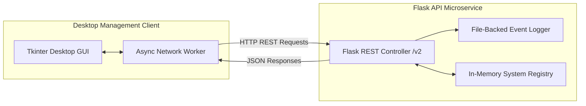

# 🛡️ Distributed Recovery System: Flask REST API & Tkinter GUI

[](https://python.org)
[](https://flask.palletsprojects.com/)
[](https://docs.python.org/3/library/tkinter.html)
[](LICENSE)

A client-server systems management and recovery orchestration application. It features a versioned RESTful **Flask API** backend for managing remote node recovery states and an asynchronous desktop **Tkinter GUI** for real-time node diagnostics, event streaming, and reboot dispatching.

---

## 🏗️ Architecture Overview



---

## 🌟 Key Features

* **Versioned REST API (`/v2/`):** Clean separation of concerns with predictable endpoints for system registration, reboot handling, and log queries.
* **Real-Time Event Auditing:** Continuous file-backed (`event_logs.txt`) and in-memory logging recording timestamps, node state transitions, and operator interventions.
* **Desktop Control Plane:** Interactive Tkinter interface providing:
  * One-click registration of new recovery nodes.
  * Live status dashboard displaying node state (`active`, `rebooting`, `offline`).
  * Real-time administrative reboot triggering.
  * Live audit log viewer.
* **Cross-Platform:** Runs seamlessly on Windows, Linux, and macOS without external heavy runtime dependencies.

---

## 📡 REST API Reference

| Method | Endpoint | Description | Payload Example |
| :---: | :--- | :--- | :--- |
| `GET` | `/v2/systems` | Lists all registered recovery systems. | *None* |
| `POST` | `/v2/systems` | Registers a new system node with timestamp. | `{"name": "Cluster-Node-01", "ip": "192.168.1.10"}` |
| `POST` | `/v2/reboot` | Dispatches a recovery reboot signal to node. | `{"name": "Cluster-Node-01"}` |
| `GET` | `/v2/logs` | Fetches historical system event logs. | *None* |

---

## 🚀 Installation & Usage

### 1. Clone the Repository
```bash
git clone https://github.com/RaoAbullah/Recovery-System-With-Flask-API-GUI.git
cd Recovery-System-With-Flask-API-GUI
```

### 2. Set Up Environment
```bash
python -m venv venv
# Windows
venv\Scripts\activate
# Linux/macOS
source venv/bin/activate

pip install flask requests
```

### 3. Start the Flask Backend Server
```bash
python server.py
# Server runs on http://127.0.0.1:5000
```

### 4. Launch the Tkinter Client GUI
In a second terminal window:
```bash
python "gui recovery system.py"
```

---

## 👤 Author
* **Rao Abdullah Nasir** — [GitHub](https://github.com/RaoAbullah) · [LinkedIn](https://www.linkedin.com/in/rao-abdullah-rajput) · [Email](mailto:abdullahnasirrao7@gmail.com)
